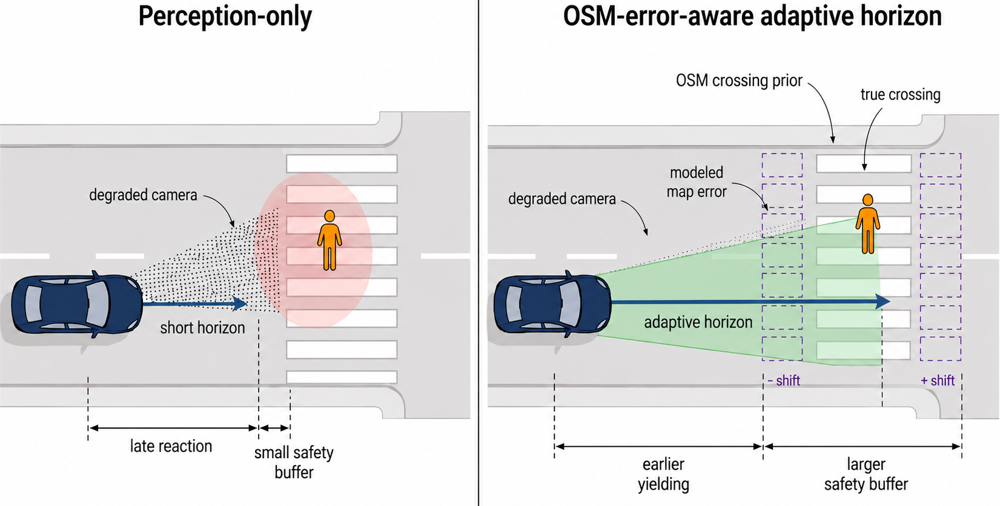
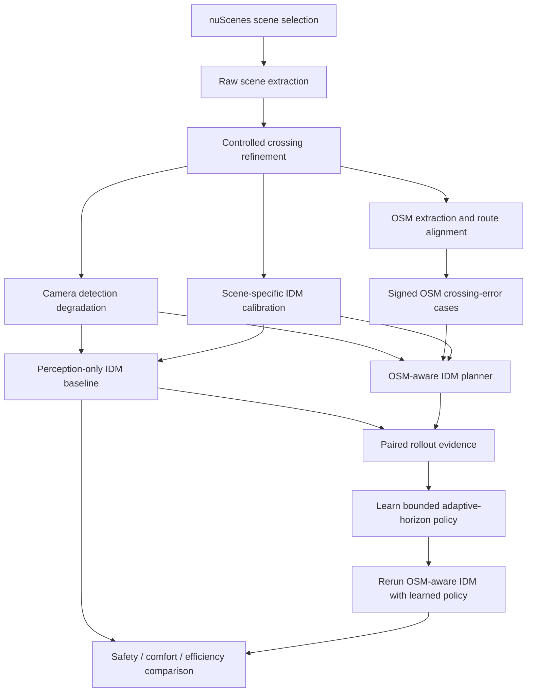
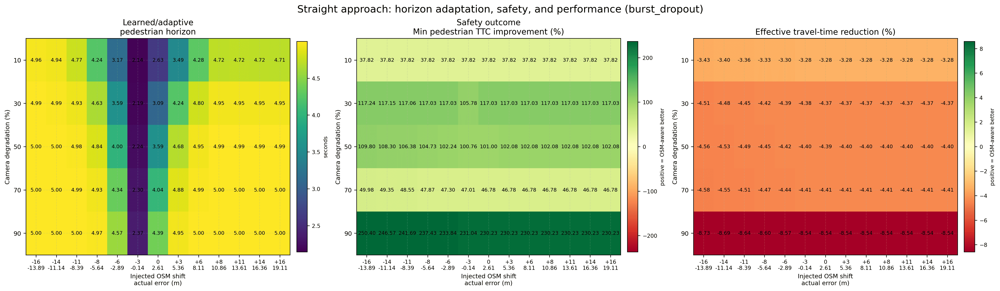
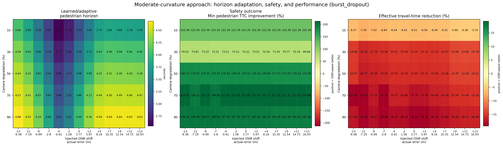
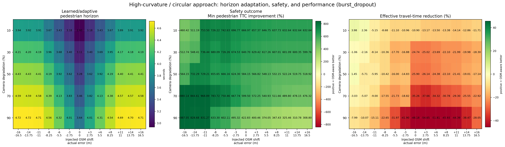
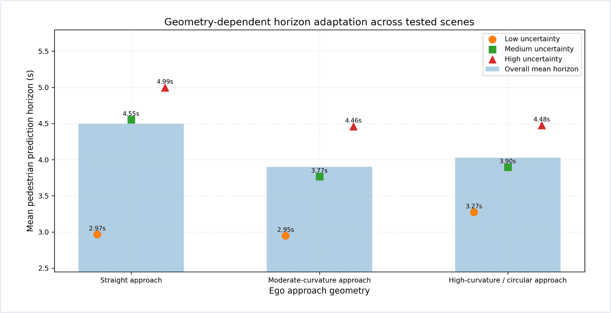
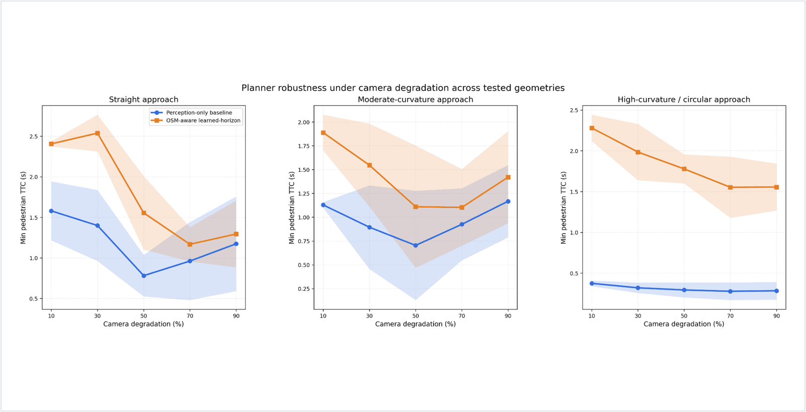
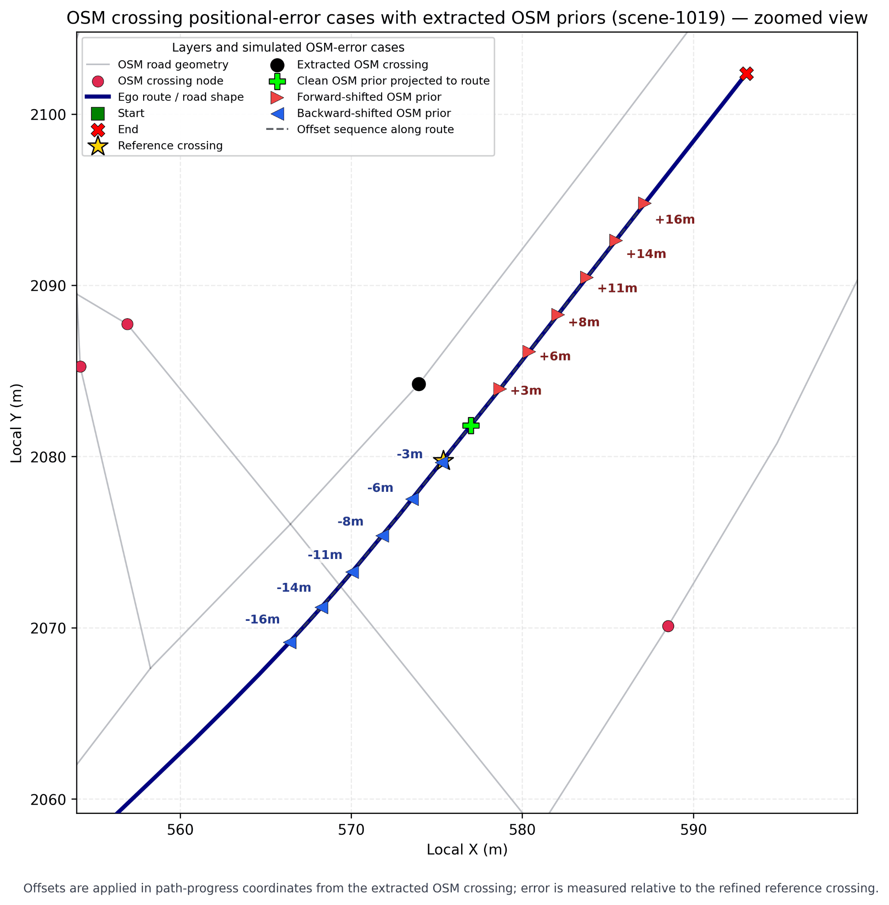
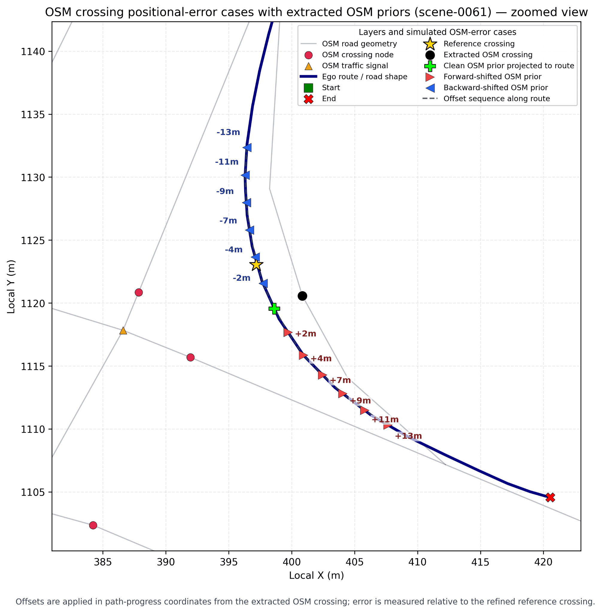
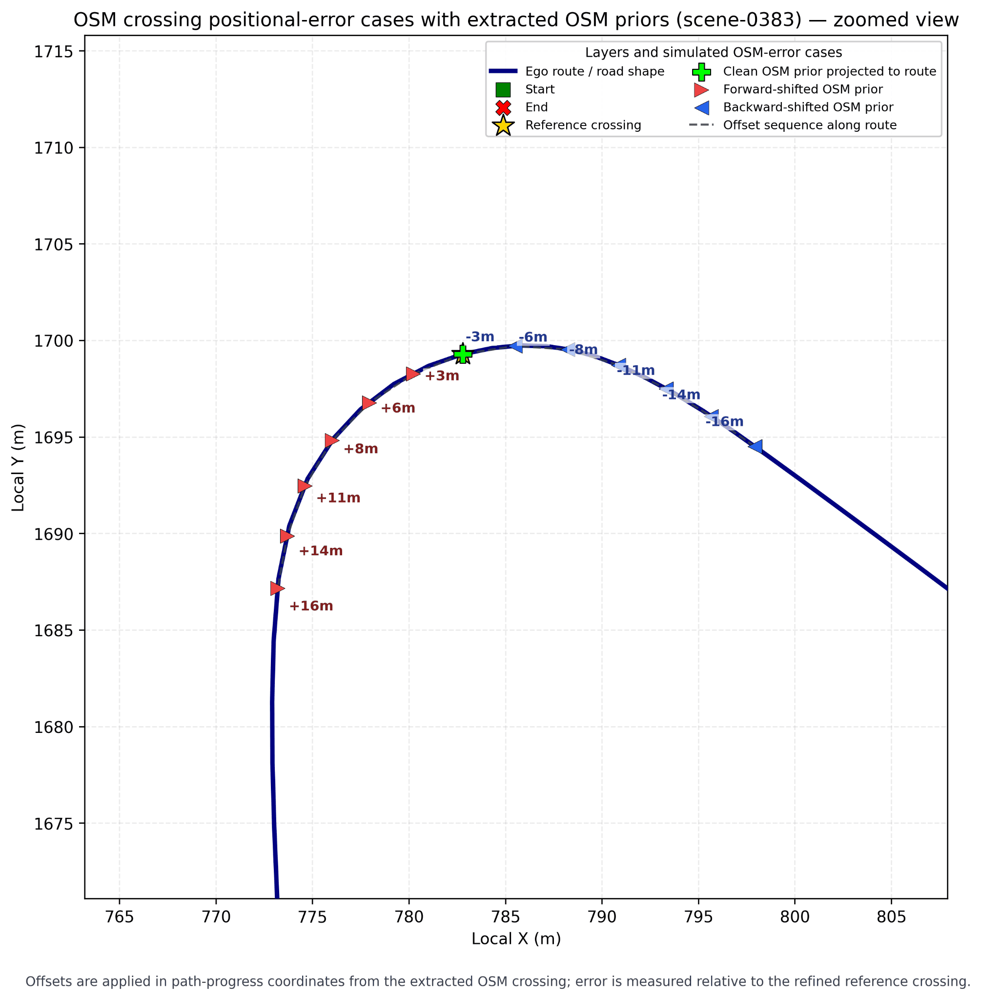

# OSM-Aware Adaptive-Horizon Planning for Pedestrian Crossing Safety

**Planning with imperfect perception and imperfect map priors.** A research-oriented autonomous-driving pipeline that evaluates whether an **OpenStreetMap (OSM) crossing prior with explicit positional uncertainty** can improve pedestrian-crossing safety when camera-derived observations are degraded.

**Focus:** autonomous driving · pedestrian safety · uncertainty-aware planning · OSM · nuScenes · Intelligent Driver Model (IDM) · adaptive prediction horizons

**Research prototype.** This repository contains 26 Python scripts, the three selected-scene configurations, calibrated IDM parameter files, fitted adaptive-horizon policies, selected rollout tables and paired comparison results. The complete original nuScenes datasets and large trajectory-level outputs are **not** redistributed. The pipeline has **not** been independently rerun on another machine.

## The research idea, visually

<p align="center">
  <a href="assets/overview/perception-vs-osm-aware-planning.png">
    
  </a>
</p>

*Conceptual comparison of the same ego-driving situation under two planning strategies. The two blue cars illustrate alternative methods, not two vehicles interacting with each other. Click the illustration to see it at full resolution.*

**Left — perception only.** With degraded or missing camera detections, a planner relying only on visible pedestrians may react late. Its short anticipation horizon leaves a smaller safety margin near the crossing.

**Right — OSM-error-aware adaptive horizon.** An OSM crossing prior provides earlier spatial context, allowing the planner to extend its prediction horizon and begin yielding sooner. The dashed crossing positions illustrate *signed map-location errors*: the crossing prior is useful but not assumed to be perfectly aligned with the actual crossing.

**What the framework tests:** whether that extra anticipation improves pedestrian safety under perception dropout **without ignoring** the additional stopping, comfort and travel-time costs. These are controlled longitudinal-planning experiments, not a claim of on-road deployment.

## At a glance

| Research component | Implementation |
|---|---|
| Baseline | Perception-only, closed-loop longitudinal IDM planner |
| Proposed variant | OSM-error-aware IDM with adaptive pedestrian/vehicle prediction horizons |
| Perception failures | Random, burst and distance-based detection dropout |
| Map uncertainty | Signed forward/backward shifts of crossing locations along the ego route |
| Learning | Interpretable bounded horizon policy fitted from closed-loop rollout outcomes |
| Evaluation | Paired safety, comfort and travel-efficiency measurements |
| Scenarios | Three nuScenes-derived, controlled pedestrian-crossing geometries |

## Research question

Camera-based pedestrian detections can arrive late, disappear temporarily or degrade with range. OSM may provide early crossing context, but an OSM crossing position can itself be shifted from the actual interaction location. Treating either perception or map information as perfect can lead to unsafe or overly conservative decisions.

This study asks: **Can an adaptive prediction horizon use imperfect OSM crossing context to improve the timing and safety of longitudinal yielding decisions under camera-perception degradation?**

The framework explicitly tests the tension between earlier anticipation and the resulting travel-time or comfort costs. It does not assume that OSM is infallible.

## Method overview



**1 — Scene selection and refinement.** Candidate nuScenes scenes are selected for vehicle approach geometry and nearby pedestrian activity. Scene timelines are extracted into planner-oriented tables, then refined to define controlled crossing interactions. Thus, the resulting scenarios are **nuScenes-derived experimental constructions**, not untouched original driving sequences.

**2 — Camera degradation.** Perception inputs are perturbed using random dropout, burst dropout and distance-based dropout. Each mode is tested across several severity levels and random seeds, providing matched degraded observations to both planners.

**3 — OSM context and positional error.** OSM pedestrian-crossing context is queried and aligned to the refined ego route. The experiment introduces controlled positive and negative shifts along route progress, representing map-prior misalignment rather than treating crossing coordinates as exact.

**4 — Common IDM baseline.** IDM longitudinal parameters are calibrated per scene and held consistent between the perception-only and OSM-aware experiments, helping isolate the effect of the crossing prior and horizon adaptation.

**5 — Horizon adaptation.** The OSM-aware planner conditions pedestrian and vehicle prediction horizons on degradation severity, observed detection loss, OSM offset/uncertainty and distance to the crossing. A bounded **rule-based fallback** first produces OSM-aware rollouts; a low-dimensional policy is then trained from outcome-guided safety, comfort and efficiency targets and used on a subsequent OSM-aware run. This is not an end-to-end neural driving policy.

**6 — Matched evaluation.** Planner outputs are compared under the same geometry, dropout mode, severity, seed and OSM perturbation. Analysis includes pedestrian time-to-collision (TTC), unsafe frames, post-encroachment time (PET, where defined), jerk, stop time and effective travel time.

## Evaluated approach geometries

| nuScenes-derived scene | Route geometry | Study context |
|---|---|---|
| `scene-1019` | Straight approach | Singapore Queenstown / Kent Ridge Crescent |
| `scene-0061` | Moderate curvature | Singapore One North / Fusionopolis Way |
| `scene-0383` | High-curvature / circular approach | Singapore One North / Biopolis Street |

Each scene is deliberately refined for a controlled crossing experiment. The three scene IDs are not presented as a broad autonomous-driving safety benchmark.

## Experiment settings

| Factor | Experimental values |
|---|---|
| Camera-degradation modes | `random_dropout`, `burst_dropout`, `distance_based_dropout` |
| Degradation levels | 10%, 30%, 50%, 70%, 90% |
| Random seeds | 0–4 (five seeds) |
| OSM positional errors | Clean map prior plus signed forward/backward along-route shifts |
| Planner variants | Perception-only IDM; OSM-aware adaptive-horizon IDM |
| Principal tradeoff | Pedestrian safety margin vs. delay, stopping and comfort |

## Reported results

The archived experiment table [`geometry_summary_key_metrics.csv`](results/experiment_data/planner_comparison/tables/geometry_summary_key_metrics.csv) reports the following average minimum pedestrian TTC values across the tested conditions. **Higher minimum TTC indicates a larger temporal safety margin** within the experiment's metric definition.

| Approach | Perception-only IDM | OSM-aware learned horizon | Change |
|---|---:|---:|---:|
| Straight — scene-1019 | 1.18 s | 1.79 s | +0.61 s |
| Moderate curvature — scene-0061 | 0.96 s | 1.41 s | +0.45 s |
| High curvature — scene-0383 | 0.31 s | 1.84 s | +1.53 s |

The reported learned pedestrian prediction horizon increased from approximately **2.95–3.27 s** in lower-uncertainty conditions to **4.46–4.99 s** in higher-uncertainty conditions. Mean unsafe-frame counts declined from **3.89 to 2.74** in the moderate-curvature case and **5.33 to 2.17** in the high-curvature case. In the latter case, effective travel time rose from approximately **9.65 s to 11.77 s**, demonstrating the safety–efficiency tradeoff.

**Interpretation:** the results support the value of explicitly uncertainty-aware map priors in these controlled scenarios. They are **not** claims of on-road deployment readiness, proven safety certification or generalization across all crossing geometries. These values are traceable to the included experiment tables, not from a fresh rerun of the scripts on a separate machine. See [experiment artifacts](docs/EXPERIMENT_ARTIFACTS.md).

## Visual results and interpretation

The following plots follow the experimental logic: **scene geometry → prediction-horizon adaptation → robustness to degraded detection → sensitivity to OSM crossing-position error**. Major result plots use a consistent full-width presentation, and all three map-error plots have equal-sized panels. Every image links to its full-resolution original.

### Horizon adaptation across the three approach geometries

The horizon/safety/performance heatmaps show how the method behaves across the tested combinations of perception degradation and crossing-prior uncertainty. Each scene is presented at the same width rather than shrinking three already-multi-panel heatmaps into one unreadable row.

**Straight approach — `scene-1019`**

<p align="center"><a href="results/figures/01_scene-1019_straight_approach_horizon_safety_performance_heatmap.png"></a></p>

**Moderate curvature — `scene-0061`**

<p align="center"><a href="results/figures/02_scene-0061_moderate_curvature_horizon_safety_performance_heatmap.png"></a></p>

**High curvature / circular approach — `scene-0383`**

<p align="center"><a href="results/figures/03_scene-0383_high_curvature_circular_horizon_safety_performance_heatmap.png"></a></p>

The same experimental factors are considered across these geometries. The resulting behavior is geometry-dependent, which motivates evaluating more than one road shape instead of optimizing only for a straight approach.

### How the learned horizon responds to uncertainty

<p align="center"><a href="results/figures/05_horizon_bar_points_across_geometries.png"></a></p>

*Mean prediction-horizon duration for each geometry, with selected uncertainty-conditioned horizon values. The policy extends its horizon in higher-uncertainty conditions, though the magnitude differs by road geometry.*

### Safety robustness as camera detections degrade

<p align="center"><a href="results/figures/06_planner_robustness_by_degradation.png"></a></p>

*Minimum pedestrian TTC versus camera degradation (10–90%) across the three geometries. The comparison shows the safety-margin advantage observed for the OSM-aware method in these controlled tests; variability bands reflect the archived evaluation rather than independent new runs.*

### Where imperfect OSM crossing priors are tested

The OSM prior itself may be misaligned. These route-aligned plots visualize the true crossing and deliberately shifted OSM crossing hypotheses used to test sensitivity to map errors. They are shown as three **equal-sized image panels**; open any panel to inspect the full-resolution axes and annotations.

<table>
  <thead><tr><th width="33%">Straight</th><th width="33%">Moderate curvature</th><th width="33%">High curvature</th></tr></thead>
  <tbody><tr>
    <td align="center"><a href="results/figures/01_straight_approach_osm_error_cases.png"></a></td>
    <td align="center"><a href="results/figures/02_moderate_curvature_osm_error_cases.png"></a></td>
    <td align="center"><a href="results/figures/03_high_curvature_circular_osm_error_cases.png"></a></td>
  </tr></tbody>
</table>

OSM positional uncertainty is part of the experiment design, not treated as ground truth. Comparison tables under [`results/experiment_data/planner_comparison/tables/`](results/experiment_data/planner_comparison/tables/) record how the planners responded to these paired perturbations.

## Inspectable experiment records

The public research package now includes selected source-generated experiment files in [`results/experiment_data/`](results/experiment_data/):

- [Paired per-condition planner comparisons](results/experiment_data/planner_comparison/tables/all_paired_key_metrics.csv) and [three-geometry aggregate metrics](results/experiment_data/planner_comparison/tables/geometry_summary_key_metrics.csv).
- [Safety–efficiency trade-offs](results/experiment_data/planner_comparison/tables/comfort_tradeoff_summary.csv), [OSM uncertainty summaries](results/experiment_data/planner_comparison/tables/geometry_uncertainty_horizon_summary.csv) and [robustness summaries](results/experiment_data/planner_comparison/tables/planner_robustness_by_degradation_summary.csv).
- Three scene-specific **IDM calibration** files and **learned adaptive-horizon policy JSONs** with training diagnostics.
- Per-run metrics from the **perception-only**, **OSM-aware rule-based** and **OSM-aware learned-horizon** planners.

These are **archived experiment outputs**, not data generated by this README or by a new verification run. Detailed provenance, directory structure and caveats are documented in [Experiment artifacts](docs/EXPERIMENT_ARTIFACTS.md). The complete raw nuScenes extracts and tens of thousands of trajectory-level files remain outside the compact repository.

## Code organization

```text
osm-aware-adaptive-horizon-planning/
├── src/
│   ├── 01_find_candidate_scenes_three_geometries.py
│   ├── 02_extract_scenes_raw.py
│   ├── 03_refine_scene_synthetic.py
│   ├── 03_refine_scene_1019.py
│   ├── 03_refine_scene_0061.py
│   ├── 03_refine_scene_0383.py
│   ├── 04_perception_degradation_all_scenes.py
│   ├── 05_calibrate_idm_parameters_scene_1019.py
│   ├── 05_calibrate_idm_parameters_scene_0061.py
│   ├── 05_calibrate_idm_parameters_scene_0383.py
│   ├── 06_run_idm_planner_all_scenes.py
│   ├── 07_extract_osm_context_all_scenes.py
│   ├── 08_generate_osm_error_cases_all_scenes.py
│   ├── 09_run_idm_planner_osm_learned_all_scenes.py
│   ├── 10_train_adaptive_horizon_policy_all_scenes.py
│   ├── 11_compare_planner_results.py
│   ├── 12_extract_scene_location_metadata.py
│   ├── ...                      # Additional single-scene and utility variants
│   ├── config/                 # Scene configurations (paths sanitized)
│   └── data/                   # Local generated outputs (ignored by Git)
├── assets/
│   ├── overview/              # Original two-strategy crossing illustration
│   └── readme-figures/        # Consistent-size preview canvases
├── results/
│   ├── figures/               # Unmodified, full-resolution research figures
│   └── experiment_data/       # Selected paired metrics and fitted policies
├── docs/
│   └── REPRODUCIBILITY.md
├── requirements.txt
├── .gitignore
└── README.md
```

The source archive contains **26 Python scripts** covering scene discovery, extraction, refinement, degradation, calibration, OSM queries/error cases, baseline and OSM-aware planning, adaptive-horizon learning, and results comparison. All 26 scripts are preserved in `src/`; the tree above highlights the batch workflow rather than listing every variant.

## Installation and execution

The code was developed for a Python environment with the nuScenes development kit, NumPy, Pandas, Matplotlib and geospatial dependencies. OSM extraction requires access to OSM data/services. Running the full experiment additionally requires the appropriate nuScenes metadata and map files.

From the repository root:

```bash
python -m venv .venv
# Linux/macOS: source .venv/bin/activate
# Windows:    .venv\Scripts\activate
python -m pip install -r requirements.txt
```

Set the nuScenes location, for example on Linux/macOS:

```bash
export NUSCENES_DATAROOT="/path/to/nuscenes"
export NUSCENES_VERSIONS="v1.0-mini,v1.0-trainval"
```

**Execute the scripts from `src/`**, because their default `config/...` and `data/...` paths generally resolve relative to the working directory. The selected-scene configuration files are included in `src/config/`. Set `NUSCENES_DATAROOT` to a locally obtained nuScenes installation; historical machine-specific `resolved_dataroot` values were cleared for public distribution. The original nuScenes datasets must be obtained separately.

```bash
cd src

# Select crossing scenes and extract raw tables
python 01_find_candidate_scenes_three_geometries.py
python 02_extract_scenes_raw.py

# Generate the controlled three-scene crossing contexts
python 03_refine_scene_1019.py
python 03_refine_scene_0061.py
python 03_refine_scene_0383.py

# Degrade perception, calibrate common IDM and evaluate baseline
python 04_perception_degradation_all_scenes.py
python 05_calibrate_idm_parameters_scene_1019.py
python 05_calibrate_idm_parameters_scene_0061.py
python 05_calibrate_idm_parameters_scene_0383.py
python 06_run_idm_planner_all_scenes.py

# Query route-aligned OSM context and generate shifted priors
python 07_extract_osm_context_all_scenes.py
python 08_generate_osm_error_cases_all_scenes.py

# Bootstrap the OSM-aware planner with the rule-based horizon
python 09_run_idm_planner_osm_learned_all_scenes.py --disable-learned-horizon-policy

# Train the bounded horizon policy from the observed rollouts
python 10_train_adaptive_horizon_policy_all_scenes.py

# Rerun using the learned policy, then compare matched results
python 09_run_idm_planner_osm_learned_all_scenes.py
python 11_compare_planner_results.py
```

**Execution status:** these commands describe the intended script dependencies; the complete sequence has **not** been validated in this review copy because the original nuScenes data and the complete intermediate trajectory-level outputs are not included. Some setups require path overrides or access to the appropriate OSM/nuScenes map data. See [data and reproducibility](docs/REPRODUCIBILITY.md) and [included experiment artifacts](docs/EXPERIMENT_ARTIFACTS.md).

## Principal generated artifacts

From the `src/` working directory, the pipeline organizes its outputs under:

- `data/raw/<scene>/` — extracted raw nuScenes timelines and metadata.
- `data/refined/<scene>/` — controlled crossing scenario tables.
- `data/idm_calibration/<scene>/` — calibrated longitudinal IDM parameters.
- `data/planner_perception_only/<scene>/` — degraded inputs, baseline rollouts and metrics.
- `data/osm/<scene>/` — extracted OSM crossing context and signed perturbations.
- `data/planner_osm_aware/<scene>/` — OSM-aware rollouts and metrics.
- `data/learned_horizon_policy/<scene>/` — learned policy JSON, diagnostics and training summaries.
- `data/planner_comparison_paper/` — paired metrics tables, robustness summaries and generated plots.

See [reproducibility notes](docs/REPRODUCIBILITY.md) for the input/output contract and dataset-sharing limitations.

## Scope and limitations

- **Longitudinal planning only:** IDM models speed and yielding; this is not a full path-planning, perception-training or closed-loop vehicle-control stack.
- **Controlled data perturbations:** camera dropout and OSM crossing offsets are simulated and should not be confused with observed real-world sensor failure statistics.
- **Limited scenario set:** three selected/refined scenes are used to analyze geometric effects; this is not a large-scale production validation.
- **Safety–efficiency tradeoff:** longer horizons and earlier braking may improve TTC but increase stopping or traversal time.
- **Reproduction requirements:** the original nuScenes data and complete intermediate trajectory-level products are not bundled; selected scene configurations, learned policy files and curated experiment tables are included.

## Attribution

Research materials supplied for this project list **Ahmad A. Mansour, Michel S. Khoueiry and Samer H. Hamdar** as authors. Authorship of the research write-up does not by itself assign individual programming contributions; source-code attribution and publication permissions should be confirmed before public release.

This project uses information from the **nuScenes** dataset and **OpenStreetMap**. Any redistributed derived data or maps must comply with the corresponding dataset and OSM attribution/licensing requirements. No blanket open-source license is assigned here.
